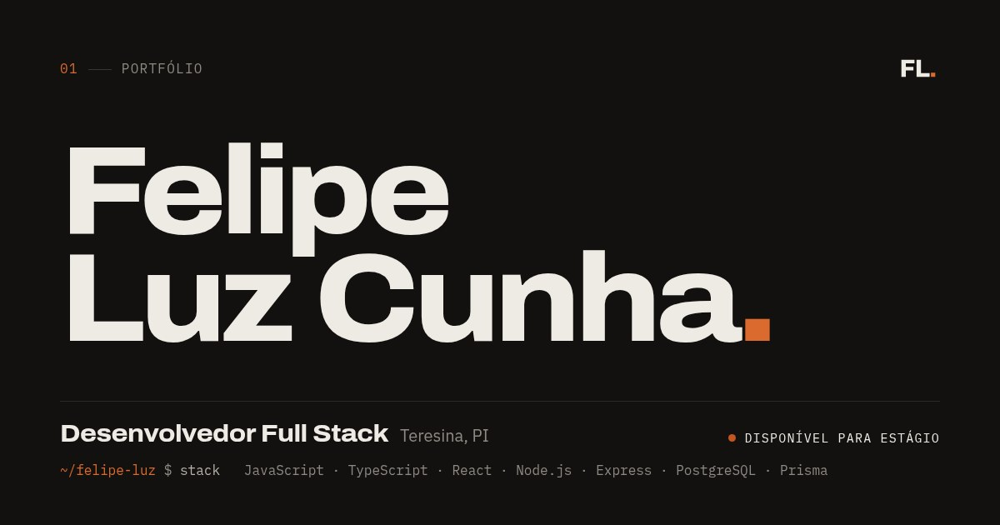

# Felipe Luz | Desenvolvedor Full Stack

Portfólio de **Felipe Luz Cunha**, desenvolvedor Full Stack em Teresina (PI), disponível para oportunidades de estágio.

**Site:** https://design-first-layout-studio.lovable.app



## Projetos em destaque

| Projeto | Demonstração | Código |
|---|---|---|
| **Agentes** (principal) | [felipesilv0607-lab.github.io/agentes](https://felipesilv0607-lab.github.io/agentes/) | [GitHub](https://github.com/felipesilv0607-lab/agentes) |
| **Finance System** | [felipesilv0607-lab.github.io/finance-system](https://felipesilv0607-lab.github.io/finance-system/) | [GitHub](https://github.com/felipesilv0607-lab/finance-system) |
| **Weather App** | [felipesilv0607-lab.github.io/weather-app](https://felipesilv0607-lab.github.io/weather-app/) | [GitHub](https://github.com/felipesilv0607-lab/weather-app) |

## Seções do site

Página única com cinco seções: **Início**, **Sobre mim**, **Projetos**, **Tecnologias** e **Contato**.

Há também um **assistente de perguntas** para recrutadores (botão no canto da tela). Ele responde apenas com as informações publicadas no próprio portfólio e avisa quando algo não está no site. As conversas ficam só na aba aberta e não são guardadas.

## Tecnologias do portfólio

- React 19 + TypeScript
- TanStack Start (rotas, renderização no servidor e rotas de API)
- Tailwind CSS v4 com tokens de design próprios
- Vercel AI SDK para o assistente de perguntas
- Vitest para os testes de conteúdo

## Rodando localmente

Requer Node.js 20+ (ou Bun).

```sh
git clone <url-deste-repositorio>
cd <pasta-do-repositorio>
npm install
npm run dev     # servidor de desenvolvimento
npm test        # testes de conteúdo e identidade
npm run build   # build de produção
```

O assistente de perguntas precisa da variável de ambiente `LOVABLE_API_KEY` no servidor. Sem ela, o restante do site funciona normalmente e o assistente mostra uma mensagem de indisponibilidade.

## Onde editar o conteúdo

Todos os textos, projetos, tecnologias e contatos ficam em um único arquivo:

```
src/content/portfolio.ts
```

Os componentes só exibem esses dados. Por isso, atualizar o portfólio não exige mexer no layout. O assistente também usa esse mesmo arquivo como base de conhecimento.

## Estrutura

```
public/                     ícones, imagem de compartilhamento, manifest, robots.txt
src/
  content/portfolio.ts      conteúdo do site (fonte única)
  components/portfolio/     seções do site e assistente de perguntas
  hooks/                    animações de entrada e seção ativa no menu
  lib/                      base de conhecimento e servidor do assistente
  routes/                   página inicial, API do assistente e sitemap
  styles.css                cores, fontes e escalas tipográficas
  test/                     testes de conteúdo, assistente e identidade
```

## Contato

- E-mail: felipesilv0607@gmail.com
- LinkedIn: https://www.linkedin.com/in/felipeluz-dev
- GitHub: https://github.com/felipesilv0607-lab
